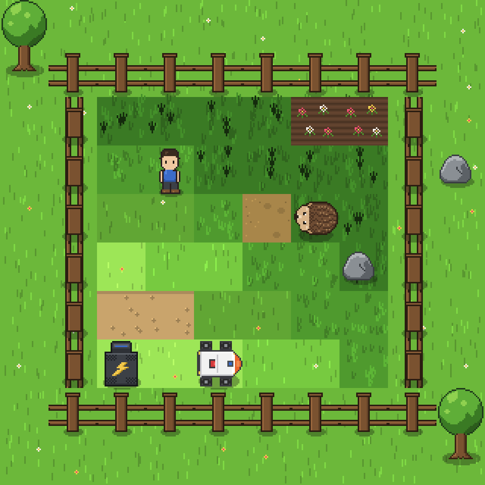

Mowbot replaces *The Farmer Was Replaced* (TFWR) in TTPG15 Vetenskaplig programmering, VT2027,
with TFWR kept as the fallback. Students program a robotic lawnmower, starting on a 3×3 lawn, from
bare fundamentals to lists and dicts. It runs in the browser on python.ju.se and is part of the
Python book. English first; a Swedish version is a later to-do.

This document settles the game mechanics, the economy, the place in the course, and how the game
and the Programming Fundamentals chapters are designed together. Implementation (Pyodide in a Web
Worker, Monaco editor in a VS Code-like shell, nginx headers) comes after and is kept out of here.

Next steps, in order: chapter outlines, then a game spike, then chapters and levels side by side.

## 1. Design spine

The game, the Programming Fundamentals chapters on python.ju.se and the numerics are designed
together from one table. Each row is one computational-thinking goal. The game level creates the
need for the concept; the chapter explains it with the mower and then transfers it to a short
numerical example, because skill in a game does not transfer on its own. Every level follows the
course's three-step rule: plan the route on paper first (no AI), then code, then check the score.

| CT goal | Python | Levels | Chapter | Transfer to numerics |
|---|---|---|---|---|
| Algorithm: exact steps in order | calls, sequence | 0 | Algorithms | hand-traced formula evaluation |
| Pattern recognition | `for`, `range` | 1 | Loops | sum of a series |
| Generalisation, state | `while`, booleans, return values | 2 | Loops | iterate until a tolerance |
| Decisions | `if/elif/else`, comparisons | 3 | Decisions | sign change in bisection |
| State and modelling | variables, arithmetic, `//`, `%` | 4–5 | Variables and state | units, step counts |
| Decomposition, abstraction | `def`, parameters, `return` | 6 | Functions | `f(x)` passed to a root finder |
| Data representation, simulation | lists, nested loops | 7 | Lists and grids | storing time steps; Euler (section 3) |
| Modularity | `import` | 8 | Modules | own `numerics.py` |
| Evaluation of algorithms | tokens per tick | all | Efficiency | error vs step size, cost of a method |
| Debugging | tracebacks, `print` | all | Debugging | finding the wrong sign |

The existing chapters `basics.qmd`, `functions.qmd`, `data_structures_builtin.qmd` and
`debugging.qmd` in `ProgrammingFundamentals/` are rewritten into these chapters: one path through
the book, no duplication. `best_practices`, `objects`, `file_io` and `version_control` stay as they
are.

Out of scope for the game: classes, exceptions, recursion, files.

The language is unlocked like the rules: using `for` before it is bought stops the run with
"You haven't unlocked `for` loops yet".

## 2. Units and coordinates

- Grass height and cutting height in **mm**. A tile is **1 m × 1 m**; yield is per m².
- Time in **ticks**. Battery and blade sharpness in **%**.
- Positions `(x, y)` in the **first quadrant**: origin `(0, 0)` at the south-west corner,
  zero-based; `East` increases `x`, `North` increases `y`. `scan()` returns `heights[x][y]`.

## 3. Grass growth is Euler, and the students write it

Grass grows by dh/dt = k (h_max − h), with h_max = 100 mm: fast when short, slower as it nears
h_max. This is the same equation as Newton's cooling in problem 1, Pajen, where T approaches room
temperature. Because growth slows, waiting longer pays less and less, which makes cutting on time
pay off without a hard cap.

- The game updates every tile each tick with explicit Euler, `h = h + k*(h_max - h)*dt`, with
  `dt` = 1 tick. The rule is shown as readable Python in a read-only "lawn rules" tab.
- Until level 7 the formula is hidden; students only see the grass grow, about 1 mm per tick when
  short.
- At level 7 the student writes `predict(h, k, ticks)`, a loop of that same line, to decide when a
  tile is ripe. It is their first Euler integration, written before they know the name.
- The week 2 lecture "Det här är numerik" names it: "you already wrote Euler in the game". Pajen
  then solves the same equation with `dsolve` and compares.

## 4. Driving

The mower steers like a real robot mower: it has a **heading** and cannot move sideways.

- `forward()` moves one tile in the heading direction, `backward()` one tile against it.
  Backward cuts like forward and costs twice the ticks.
- `turn_left()`, `turn_right()` rotate 90° in place. A turn costs battery like a move.
- `get_heading()` returns `North`, `East`, `South` or `West` (from level 2).
- The heading is state the student must keep track of. `face(direction)` and `go_to(x, y)` are
  functions the students write themselves; they are never unlocked.

## 5. Cutting

There is no `mow()`. The mower **cuts while it drives**: with the blade on, every tile it drives
into is cut. It cannot cut in place, and the start tile is cut only when driven into again.

- **At most 10 mm per pass**, never below the cutting height (20 mm). Grass at 50 mm needs three
  passes: 50 → 40 → 30 → 20. Passes needed = `(h - 20) // 10`, plus one if there is a remainder.
- The level 0 lawn starts at 30 mm, so one pass is enough there.
- From level 11, tall grass cuts worse: above 60 mm a pass removes only 5 mm. Robot mowers trim
  little and often; in tall grass the blade pushes the stalks down instead of cutting them.
- `blade_on()`, `blade_off()`: the blade is on from level 0; switching it unlocks at level 3.
- Income: **1 token per mm removed** on a 1 m² tile.

## 6. Core rules from level 0

- Grass grows as in section 3.
- Costs: `forward` 10 ticks, `backward` 20, a turn 5; cutting adds 10 ticks to the move.
- Two incentives are built in from the start. **On time**: growth slows as grass gets tall, so a
  tile left waiting earns less per tick. **Efficient**: the score is tokens per 1000 ticks, so
  extra turns and empty drives cost.

## 7. Levels

Each level adds one rule and one concept.

| Lvl | New rule | New functions and language | Concept forced |
|---|---|---|---|
| 0 | core, 3×3, mower at (0,0) facing North | `forward`, `backward`, `turn_left`, `turn_right` | sequence of calls |
| 1 | grass regrows: run it again | **`for`**, `range` | repetition |
| 2 | lawn grows to 4×4, 5×5; the edge is a wall | `get_x()`, `get_y()`, `get_heading()`, `get_lawn_size()`, `forward` returns `True/False`, **`while`** | state and size not hard-coded |
| 3 | cutting short grass wastes ticks | `grass_height(direction)` (tile ahead), `blade_on/off`, **`if`** | decide before acting |
| 4 | **battery**: a move or a turn 1 %, cutting +1 %; empty = stop | `get_battery()`, `manual_recharge()` (500 ticks) | variables, thresholds |
| 5 | **blade dulls**: −0.1 % per mm cut; cutting ticks = 10 / sharpness; income × sharpness | `get_blade()`, `manual_sharpen()` (500 ticks) | arithmetic, trade-offs |
| 6 | **station** at a fixed tile: charge and sharpen in 50 ticks | `get_station()`, `charge()`, `sharpen()` (on the station only), **`def`**, `return` | write `face(d)`, `go_to(x, y)`, `go_home()` |
| 7 | **growth rates differ** per tile (k high in sun, low in shade); growth law revealed | `scan()`, `get_growth(x, y)`, **lists**, nested loops | write `predict(h, k, ticks)` (Euler); remember which tiles ripen when |
| 8 | — | second editor tab, **`import`** | helpers into a module |
| 9 | **flower beds and paths**: driving a bed with the blade on costs 200 tokens | `get_ground(direction)`, `and/or/not` | conditions on more than one thing |
| 10 | **lawn shapes**: L shape, house in the middle | `is_clear(direction)` | general algorithms, no rectangle |
| 11 | **cutting height** and **tall grass**: above 60 mm a pass removes 5 mm, not 10 | `set_cut_height(mm)` | multi-pass planning, `//` and `%` |
| 12 | **moving obstacles**: a hedgehog at random, a person on the arrow keys (lab partner); a hit stops the run | — | check before every move |
| 13 | **contracts**: stripes follow the driving direction; customers order stripes, a checkerboard, a border | **dicts**, tuples as keys, `%` | final challenges |

Levels 0–7 are the **core**, done by the end of course week 2. Levels 8–13 are the **advanced**
track, optional and open until the week 8 check, as TFWR is today; 12 and 13 can be dropped.
Slopes are parked.

## 8. Modes

- **Normal**: battery and blade are on from their levels.
- **Easy**: the battery never drains and the blade never dulls. A per-student setting for
  learning. The final challenges run in normal mode, since battery and blade are what make
  `go_home()` necessary.

## 9. Economy

- **Income** = mm removed × m² × blade sharpness (sharpness from level 5).
- **Spending**: tokens buy unlocks (language features, functions, the next level) and upgrades.
- **Prices** roughly double per level: a naive sweep reaches the next level slowly, a timely and
  efficient program quickly. First table, to be tuned by simulation and play-testing:

| Unlock | Price (tokens) |
|---|---|
| `for` | 200 |
| 4×4 lawn, `while`, position and heading | 500 |
| `grass_height`, blade switch, `if` | 1 000 |
| battery level, `get_battery` | 2 000 |
| blade level, `get_blade` | 4 000 |
| station, `def` | 8 000 |
| lists, `scan`, growth map | 12 000 |
| `import` | 20 000 |
| each later level | ×1.5–2 |

- **Upgrades** change speed or limits only, never a concept. In tiers: motor (move 10 → 7 → 5
  ticks), faster turning, battery capacity, blade hardness (dulls slower), lawn size.
- **Score**: tokens per 1000 ticks, shown after every run.

## 10. Final challenges (G/U at the computer, normal mode)

1. An unknown lawn shape with flower beds, mowed without a penalty.
2. A mixed-growth lawn kept above a target score for a set time.
3. A customer pattern.

Oral check: the student explains their `go_home()` and one decision in their code.

## 11. Place in TTPG15 (VT2027)

- **Lab time**: the 16 supervised hours of weeks 1–2 (two 4 h sessions per week), which TFWR has
  today; no extra budget. Core check-off (G/U, the group explains at the computer) by the end of
  week 2; the advanced track until week 8.
- **Lectures**: both week 1 lectures are on fundamentals with Mowbot, live-coded together.
  Lecture 1: sequence, `for`, `while`, `if`. Lecture 2: variables and state, `def`, lists. The
  lectures run ahead of the game, so the whole core is introduced in week 1. Study technique goes
  into lecture 1 or week 2.
- **Week 2** starts the numerics as planned, opening with "Det här är numerik" built on the game's
  growth rule (section 3), then Pajen with Euler-Cromer.
- **Why not all four lectures of weeks 1–2**: it would shift the numerics and the project
  deadlines by a week. The group presentations (18 groups × 6 project problems = 108, 15–20 min
  each, in lab time) would then have to fit into weeks 5–8 instead of 4–8.
- **The numerics timeline sets the core**: Pajen (week 2) needs `for` and lists; bisection and
  Newton (week 3) need `while`, `if` and `def`. Hence lists at level 7 in the core, and `import`
  in the advanced track.
- **Reading for weeks 1–2**: the Programming Fundamentals chapters, matched to the levels.
- **Workload**: 7.5 hp over 8 weeks is about 25 h per week. Core levels at 1–2 h each fit in the
  lab hours plus some play at home.
- **To update in the course documents** (`~/ScientificProgramming/kurstillfallen/VT2027/`):
  `planering.qmd` line 136 says one 4 h session per week, it is two. In the course guide, week 1
  lectures become the two Mowbot lectures, "Det här är numerik" moves to week 2, and TFWR is
  replaced by Mowbot (structure, tools table, week plan) once this design is settled.

## 12. Graphics theme

Top-down pixel art in the style of the hand-drawn tilesets sold for 2D games: chunky tiles, a
small saturated palette, every object in three tones with a tinted outline and a soft shadow. All
sprites and colours are our own; nothing is copied from any existing game or tileset, and no
names or characters from one appear.

- **Tiles** are 32 × 32 px at native size, drawn with integer scaling (×2 or ×3) and
  `image-rendering: pixelated`, so the pixels stay crisp. The mower fills one tile.
- **Three tones and a tinted outline**: each object has a light cap, a mid body and a dark base,
  outlined in its own colour darkened, never plain black. Every object casts a soft elliptical
  shadow. This is what makes a tileset look rich; flat fills with black outlines look like a
  placeholder.
- **Grass varies per tile**: short blades in a lighter and a darker shade, scattered from a random
  generator seeded by the tile position, so the lawn is textured but stable between frames. Short
  grass gets the odd daisy or buttercup.
- **Grass height** is shown by tile colour in four tiers, with more and taller blades per tier and
  dark clumps on overgrown grass, so a student reads the lawn at a glance: cut, growing, ripe,
  overgrown. A scalped tile is brown with stubble.
- **Stripes**: a tile remembers the direction of its last cut and is drawn 10 % lighter or
  darker, so a neat program leaves a striped lawn and a messy one a patchwork. This is cosmetic
  until the contracts at level 13.
- **Surroundings**: a wooden fence of posts and rails around the lawn, with grass, round trees
  and stones outside it, so the lawn sits in a garden rather than on a dark page.
- **Sprites**: the set below; flower beds as tilled dark soil with red, yellow and white
  blossoms; paths in sand with pebbles; stones in grey. Each sprite's legend carries its own
  colours, within the palette's character.
- **Chrome**: the game canvas sits inside the VS Code-like shell in its dark theme, so the
  saturated lawn pops. Battery and blade meters live in the status bar in the shell's colours.
- **Animation**: the mower slides one tile per move at the speed-slider rate; cut tufts flick off
  the tile; the hedgehog ambles. Nothing more; the lawn must read as a state, not a show.

Palette (ours, hex), limited on purpose:

| Role | Colour | Role | Colour |
|---|---|---|---|
| grass cut | `#8fd14f` | outline | `#1e2a1a` |
| grass growing | `#6cb83a` | mower body | `#e8632b` |
| grass ripe | `#4f9a2e` | mower accent | `#f5f0e6` |
| grass overgrown | `#3a7a24` | wheels, shadow | `#2b2b2b` |
| stripe light / dark | +8 % / −8 % lightness | station, shirt | `#3b6bc9` |
| scalped | `#a8864a` | flower red / yellow | `#e84c6a` / `#f3c84b` |
| path (sand) | `#c9a46c` | flower bed soil | `#5a3e2b` |
| stone | `#8a8f94` | fence wood | `#7a5230` |
| hedgehog body / face | `#6b4a31` / `#d9b48a` | skin, hair | `#f0c9a0` / `#3a2a1e` |

**Sprites are hand-authored character grids** in `graphics/sprites.py`: one letter per pixel,
a legend per sprite, 32 × 32 (the tree 32 × 48). A sprite is drawn facing one way and rotated
to its heading, which is lossless for top-down art. The set:

- **Mower**, facing north: a four-wheel robot mower from above in the shape of the current
  all-wheel-drive machines. The heading must be readable at a glance, so the front and the rear
  differ in every way: a tapered orange nose with yellow headlights at its corners and the sensor
  tower with its blue lens just behind, against a flat dark rear with a seam, the red stop button
  and yellow rear lights. White hull, black treaded wheels with grey hubs hugging the hull. Four
  headings.
- **Charging station**: a flat black pad with a raised back at its north end, grille mesh on
  both sides, a blue LED strip on the back and a classic yellow lightning bolt in the middle. The
  mower docks facing north onto it.
- **Hedgehog**, facing south: a ball of dark and light spines with a tan face, ears, eyes with a
  glint and a nose. Four headings.
- **Person**: front-view chibi, big head, dark hair, blue shirt, dark trousers, brown shoes.
- **Rock**: a faceted boulder lit from the top-left, with a crack.
- **Tree**: one crown with two highlight clusters top-left, dark underside, trunk with roots.

`graphics/swatch.py` draws the palette with its tones (`palette.png`), a sprite sheet with every
sprite in every heading (`sprites.png`, ×5) and the mock lawn (`mock_lawn.png`, ×3). Edit the
grids and re-run; the sheet is the place to judge a sprite, the lawn the place to judge the whole.
The grids and the tile painters port to Canvas 2D as the game's renderer; drawing the grids once
into an offscreen sprite sheet at load time keeps it fast.

{width=75%}

{width=75%}

Known rough edge in v0.7: the overgrown tier's dark clumps are harsh.

An alternative is a licensed tileset (the hand-drawn sets sold on asset marketplaces, or a CC0
set); it would be richer still but fixed in content, and the licence must allow a public website.
Decision: own generated art first, a licensed set as the fallback if the spike still looks flat.

## 13. Open questions

- Growth constant k: which values give about 1 mm per tick for short grass and ripe tiles at a
  pace that suits the levels? Settled by simulation in the rules engine, before the spike.
- Tall grass is a step rule (10 mm per pass, 5 mm above 60 mm) for now; a continuous function
  may replace it later.

## 14. Verification of the design

The game cannot be played before it is built, so the design is checked in two steps. A short
Python simulation of the rules runs a naive sweep against a good program for each core level and
checks the prices and the growth constant. The spike then lets Mirza play levels 0–3 for real,
and the level table is revised from that before the chapters are written.

## Decision log

- **2026-11-18**: Mowbot replaces TFWR in VT2027, TFWR is the fallback. Hosted on python.ju.se,
  English first, Swedish later.
- **2026-11-18**: tokens are earned only by cutting grass; units mm; a tile is 1 m².
- **2026-11-18**: origin south-west, first quadrant. A north-west matrix origin was considered and
  rejected, to match the maths figures.
- **2026-11-18**: forward, backward and turns with a heading; no sideways moves.
- **2026-11-18**: cutting only while driving, no `mow()`. At most 10 mm per pass; from level 11
  only 5 mm above 60 mm. The one-third rule was rejected because it rewards tall grass.
- **2026-11-18**: easy mode without battery drain and blade dulling; final challenges in normal mode.
- **2026-11-18**: growth dh/dt = k (h_max − h) by explicit Euler, the equation of Pajen; students
  write `predict` at level 7. Replaces a linear growth with a hard cap.
- **2026-11-18**: lists moved into the core (level 7) and `import` to the advanced track, to match
  the numerics in weeks 2–3.
- **2026-11-18**: both week 1 lectures on Mowbot; numerics start in week 2 as planned. Four game
  lectures were rejected because they shift the group presentations.
- **2026-11-18**: game and Programming Fundamentals chapters are designed together from the design
  spine; the existing fundamentals chapters are rewritten, not kept beside the new ones.
- **2026-11-18**: `backward()` cuts, at twice the ticks of forward; a turn costs battery like a
  move.
- **2026-11-18**: graphics are top-down pixel art with our own palette and sprites; no assets or
  names from existing games. Verification by simulation and the spike, not on paper.
- **2026-11-18**: tiles raised from 16 to 32 px, with three-tone shading, tinted outlines,
  shadows and seeded per-tile grass variation, after Mirza asked for richer art in the style of
  hand-drawn tilesets. Own generated art first; a licensed tileset is the fallback.
- **2026-11-18**: sprites become hand-authored pixel grids (sprites.py) after Mirza's references:
  mower in the form of a modern four-wheel robot mower, station as a flat pad with the power
  symbol, hedgehog and person redrawn, tree as one crown.
- **2026-11-18**: station symbol changed to a classic lightning bolt; mower redrawn with a
  tapered nose, headlights and a flat rear so the heading is readable. Sprites approved by Mirza
  otherwise.
- **2026-11-18**: this document is `DESIGN.qmd` in the public repo github.com/cenmir/mowbot, rendered to PDF
  on Euler by `render_design.sh`, which puts every render in
  `D:\Dropbox\Work\Kurser\CompScience\Mowbot_DESIGN.pdf` next to the course guide.
- **2026-11-18**: tall-grass rule stays a step for now (continuous function possible later);
  k is tuned by simulation. Design declared ready to build; the build starts with the rules
  engine in Python, then the browser spike.
