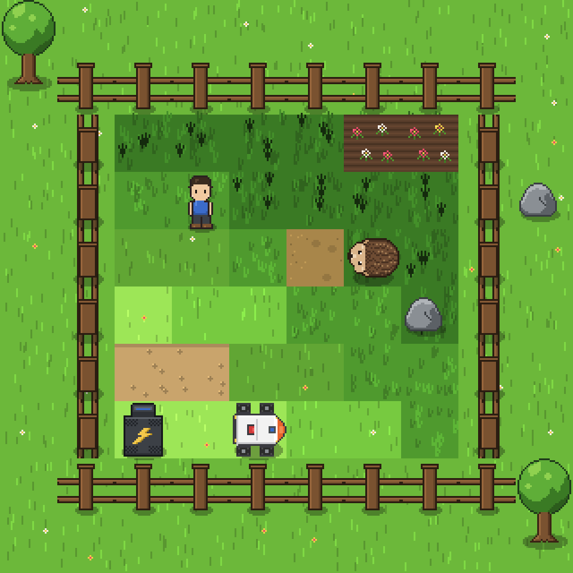

# Mowbot

A browser game for learning Python: you program a robotic lawnmower, starting on a 3×3 lawn,
and unlock the language one concept at a time, from calling functions to lists and dicts. Real
CPython runs in the browser; the code you write is the code you will write in Jupyter afterwards.

Built for the course *Vetenskaplig programmering* (TTPG15) at Jönköping University, where it
replaces a commercial game from 2027. It will be served at python.ju.se as part of the Python book.

## Status

Spike. The rules engine is done and tested; the browser page runs levels 0–3 with the editor,
the lawn, Run, Stop, the speed slider and the unlock ladder. The design is in
[DESIGN.qmd](DESIGN.qmd) (rendered to PDF by `render_design.sh`), with a decision log at the end.

## Playing it locally

```
uv venv .venv
uv pip install --python .venv/bin/python pillow pytest
python3 web/fetch_vendor.py        # Pyodide and the Monaco editor, once per checkout
python3 web/serve.py               # then open http://localhost:8077/web/
```

The server adds the two cross-origin isolation headers the page needs for `SharedArrayBuffer`;
a plain file server will not do. Python runs in a Web Worker, so the page never freezes.

## Layout

| Path | What |
|---|---|
| `mowbot/` | the rules engine in plain Python: `lawn.py`, `game.py`, `levels.py`, `gate.py`, `api.py` |
| `tests/` | one test per rule; `.venv/bin/python -m pytest` |
| `sim/compare.py` | a naive sweep against a careful program per level, for tuning growth and prices |
| `web/` | the page: `index.html`, `style.css`, `app.js` (shell), `render.js` (canvas), `py-worker.js` (Pyodide) |
| `web/assets/` | the sprite sheet the page draws from, built by `graphics/build_sheet.py` |
| `graphics/sprites.py` | every sprite as a hand-authored pixel grid, one letter per pixel |
| `graphics/swatch.py` | draws the palette, a sprite sheet and a mock lawn from the grids |
| `DESIGN.qmd` | the design document; `render_design.sh` renders it to PDF |

After a change to the sprites or tile painters: `.venv/bin/python graphics/build_sheet.py`.


